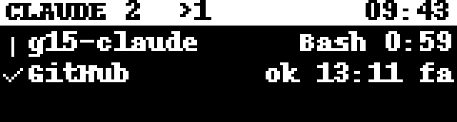

# g15-claude

Show the status of your [Claude Code](https://claude.com/claude-code) sessions on the LCD of a Logitech G15 keyboard.



Each running session gets a row, sessions that need you come first:

| Icon | Meaning |
|------|---------|
| spinner | working — current tool and elapsed time |
| blinking `!` box | waiting for a permission |
| `?` | waiting for your input |
| ✓ | finished — how long ago |

The header shows the number of sessions, how many are working (`>`) and how many need you (`!`), plus the clock. With more than 3 sessions the display pages every 4 seconds.

## How it works

- **No Logitech software needed.** G HUB does not support the G15 v1 LCD, so `g15lcd.py` talks to the keyboard directly over HID (protocol from [libg15](https://sourceforge.net/projects/g15tools/)): output report `0x03`, 992 bytes = 32-byte header + 160×43 pixels in 6 bands of 8 rows.
- **Session list:** Claude Code keeps a registry of live sessions in `~/.claude/sessions/<pid>.json` (status `busy`/`idle`). Every live session shows up, even ones started before the hooks were installed.
- **Details via hooks:** `hook.py` is registered as a Claude Code hook (`SessionStart`, `UserPromptSubmit`, `PreToolUse`, `PostToolUse`, `Notification`, `Stop`, `SessionEnd`) and writes per-session state to `~/.claude/g15/sessions/`. That adds the current tool and permission prompts.
- **App:** `app.py` runs in the system tray and refreshes the LCD 4 times per second.

## Install

Download `G15ClaudeStatus-Setup-x.y.z.exe` from the releases and run it (per-user, no admin). The installer can:

- start the app with Windows;
- add the hooks to `~/.claude/settings.json` (the rest of the file is left untouched; uninstalling removes them).

Restart any open Claude Code session afterwards so it loads the hooks.

## Build from source

Requirements: Windows, Python 3.13, [Inno Setup 6](https://jrsoftware.org/isinfo.php) (`winget install JRSoftware.InnoSetup`).

```powershell
python -m venv .venv
.\.venv\Scripts\pip install -r requirements.txt
.\build.ps1          # -> Output\G15ClaudeStatus-Setup-<version>.exe
```

For development, run without building:

```powershell
.\.venv\Scripts\python app.py                     # tray app
.\.venv\Scripts\python daemon.py --preview        # render preview.png instead of the LCD
.\.venv\Scripts\python app.py --install-hooks path\to\g15claude-hook.exe
```

## Files

| File | Purpose |
|------|---------|
| `g15lcd.py` | minimal HID driver for the G15 LCD |
| `daemon.py` | collects sessions and renders the screen |
| `hook.py` | Claude Code hook (stdlib only, ~50 ms) |
| `hookcfg.py` | adds/removes the hooks in `settings.json` |
| `app.py` | tray app and command-line entry point |
| `g15claude.spec` | PyInstaller build: `g15claude.exe` + `g15claude-hook.exe` |
| `installer.iss` | Inno Setup installer |

Tested with a G15 v1 (USB `046D:C222`). The G15 v2 (`046D:C227`) uses the same LCD format and is enabled, but untested.
